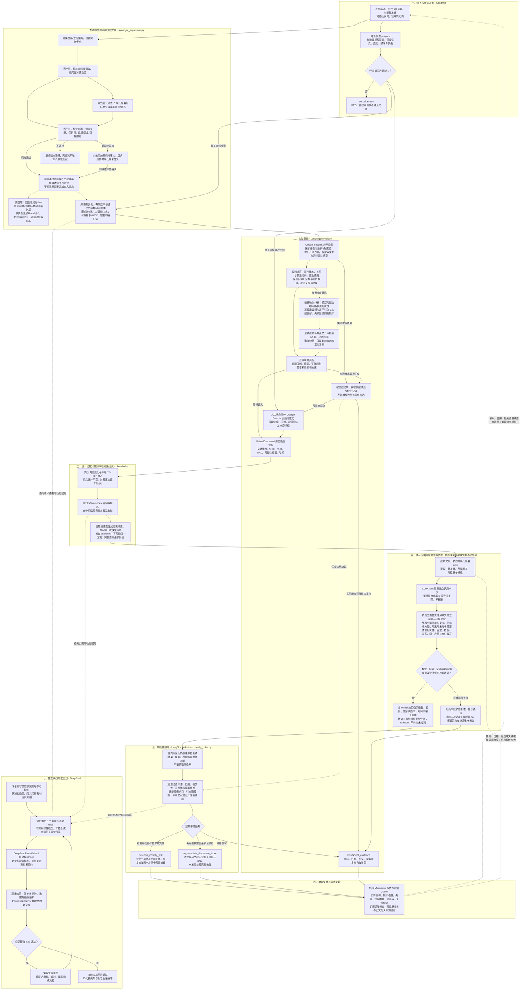

# Google Patents 新颖性预筛 Harness

> **材料接手与案件留存**：在现有主流程中接入材料上传、原件哈希、AI 对话整理要素与案件结果保存。使用与限制见 [材料接手说明](docs/local-integration.md)。保存材料不调用模型；新颖性规则保持有效；0.3.0 将网页人工逐项复核替换为大模型逐项复核。

当前本地版本：**0.6.0**（模型为主的统一证据对照，开发中，见 [VERSION](VERSION)）。[版本记录](CHANGELOG.md) · [版本与提交约定](CONTRIBUTING.md)。

0.6.0 将 LlamaIndex 定位与模型辅助对照接成[统一证据对照流程](docs/model-evidence-alignment.md)：本地检索逐篇提供阅读线索，模型检查全部快照，主要依靠对技术含义及完整限定的理解建立“技术要素—原文证据”对应关系。未命中或低分段落仍可作为证据，每项保留逐字引文、位置和支持/矛盾/未知的说明。主界面每篇一次模型请求；兼容的旧建议入口共用语义指令和引文校验，仍只产生候选。

保存新材料保留当前工作内容；显式切换前另存草稿。AI 整理结果按轮留存，文字附件引文可机械回查；材料未知项和未校验出处进入判断限制。新快照记录原文编号和锚点，候选与最终复核分开；模型复核记录服务、模型名、提示词版本、时间和输入绑定；历史人工记录单独保留。见[证据定位与复核说明](docs/evidence-review.md)。第三阶段增加[逐要素检索记录与相关性关卡](docs/search-evidence.md)，保留实际查询和失败，超长查询明确拒绝。

把一个发明想法整理成技术要素，从 **Google Patents** 获取文献，逐篇生成可回查原文的要素对照，再依据 **CNIPA 新颖性规则**给出有范围限制的预筛结果。

三个 skill 分别负责 **LangGraph 流程编排、LlamaIndex 证据检索、DeepEval 基础评测**，均有独立 Python 实现、中文注释、技能说明和基础 eval。

| 项目范围 | 当前实现 |
|---|---|
| 判断目标 | 中国发明/实用新型场景的新颖性预筛 |
| 资料来源 | 本次从 Google Patents 取得或人工录入的原文段落快照 |
| 比对单位 | 用户确认的整套技术要素；暂不区分独立/从属权利要求，不展开从属引用 |
| 大模型逐项复核 | 逐篇核查相关性、同义词与完整限定、引文、上下文、同一方案及充分公开；来源明确记为模型 |
| 交付 | 新颖性 Markdown 报告、证据与判断 JSON、独立的基础 eval 记录 |

0.4.0 增加[同义词四层扩展](docs/synonym-expansion.md)：预定义词典 → LLM中英/缩写候选 → 规则及新增词审核 → 扩展前后Recall@K、Precision@K与成本Eval。理论类保留专名、小范围替换；工程类增加部件/结构表达及双术语组合。新增词只服务查询，不写入法律等同或证据嵌入词典。

0.5.0 增加[候选排序与相关文献判断](docs/candidate-ranking.md)：先按部件、关系及提及语境排序，再按需调用模型核查标题/摘要；追加正文后逐篇复核。分别统计扩展独有候选、元数据相关和正文相关，不能用候选数代替召回质量。

## 完整工作技术流程图

下图对应当前代码实现。**实线表示业务处理，虚线表示配置输入、重新处理或离线评测关系。** 自动候选经大模型逐篇逐项复核和程序校验后进入判断；模型复核不等于人工确认，离线 eval 不为实际报告背书。



**执行细节：**状态图节点为 `prepare → retrieve → locate_evidence → decide`。第一次获取候选时尚未逐项复核，因此通常返回“证据不足”；点击第 3 步后，界面通过 `model_review_documents` 每篇调用一次模型，严格校验后用同组快照重跑判断。模型调用在用户确认外发内容后执行，未配置密钥时仍可检索及查看候选。快照先保存在当前会话中，导出 JSON 时才保存为可下载记录。

## 快速启动

在项目根目录运行：

```powershell
.\start_novelty.ps1
```

如果 PowerShell 限制脚本执行，可直接启动：

```powershell
.\.venv-novelty\Scripts\python.exe -X utf8 -m streamlit run app.py
```

首次从源码安装需要可用的 Python 3.10+：

```powershell
py -m venv .venv-novelty
.\.venv-novelty\Scripts\python.exe -m pip install -r requirements.txt
.\.venv-novelty\Scripts\python.exe -X utf8 -m streamlit run app.py
```

使用专用的 `.venv-novelty` 环境。三个框架的已验证版本固定在 [requirements.txt](requirements.txt)；LlamaIndex 只安装 core，默认使用本地嵌入。模型辅助可在侧栏设置，也可复制 [.env.example](.env.example) 为 `.env` 后填写；默认服务为 DeepSeek。

## 实际操作

1. **确认判断对象。**填写发明描述、基准日与技术要素，每行一个，保留连接关系、步骤、否定和数值。涉及优先权时，先人工确定适用基准日。
2. **选择扩展策略并取得文献。**在“同义词四层扩展与检索评测”选择理论或工程类，可设置保护术语；按需生成中英候选，词典外新词须选中并确认技术含义后才查询。点击第 1 步检索 Google Patents，或直接粘贴同一来源的原文。人工录入需填写链接、日期，并保留相关权利要求和说明书上下文。
3. **改善候选排序并补取文献。**查看实际查询、未查询要素、排序线索和正文状态。展开“改善候选排序与补充相关文献”，可确认外发后让模型判断所选标题/摘要并重排，再选择尚未取得正文的候选追加读取。标题/摘要相关判断不替代正文逐项复核，未知候选仍可选择。
4. **模型建立要素—原文证据对照并复核。**配置模型，选择文献，展开查看要素、完整原文、本地候选及定位线索，确认后点击“调用大模型逐项复核并预筛”。每篇一次请求，模型以技术含义和全部限定为主要依据，独立解释证据支持关系，可纠正候选并引用未命中段落；无法确定时保留 `unknown`。
5. **查看结果。**程序校验全部要素、全部段落覆盖声明、JSON 类型及逐字引文。模型判定上下文足够且快照有权利要求/说明书结构提示或原始完整标记，才满足自动预筛的完整性门槛；原始快照不被改成“人工确认”。未选文献、获取/校验失败和未知项保留为缺口。
6. **导出记录。**下载 Markdown 与 JSON。更改要素、日期、对应原文或模型设置会使相应复核失效；选择文献只决定下次调用范围，其他有效记录保留。重试失败清除本次所选文献的旧复核。模型记录可追溯，但不是专业准确率认证。

### 要素对照状态

| 状态 | 表达的事实 | 复核要求 |
|---|---|---|
| `disclosed` | 该文献原文披露了这个技术要素 | 提供逐字引文、段落位置和方案编号；核对同义表述及全部限定 |
| `not_found` | 本次检查该文献时未找到这个要素 | 不能扩展为其他文献不存在，也不能当作产品缺少该要素 |
| `unknown` | 资料或技术含义不足以判断 | 保留不确定性，补充资料或人工核验 |

### 三类新颖性结果

| 结果 | 何时出现 | 应如何理解 |
|---|---|---|
| 发现单篇文献完整披露风险 | 至少一篇基准日前公开文献满足全部要素、同一方案、有效引文、上下文完整性及有效逐项复核要求 | 提示新颖性风险，仍需专业复核 |
| 本次已复核文献中未发现完整披露 | 当前全部文献都已完整复核，无未知或其他缺口，且未发现单篇完整披露 | 仅说明本次证据范围内的结果，不能推导出可授权 |
| 证据不足 | 检索或正文失败、日期不明、要素未知、尚未复核，或存在其他待核验情况 | 补充证据并重新判断 |

FTO、侵权等其他任务返回 `out_of_scope`，不进入在线检索。

## 三个 skill 与代码分工

| Skill | 独立实现与说明 | 主要职责 |
|---|---|---|
| `patent-langgraph` | [langgraph_skill.py](skills/langgraph_skill.py) · [SKILL.md](.agents/skills/patent-langgraph/SKILL.md) | 状态图、同义词查询编排、有界获取、候选对照与规则调用 |
| `patent-llamaindex` | [llamaindex_skill.py](skills/llamaindex_skill.py) · [SKILL.md](.agents/skills/patent-llamaindex/SKILL.md) | 本地嵌入与阅读线索，接入统一模型证据对照；返回原始父段和出处 |
| `patent-deepeval` | [deepeval_skill.py](skills/deepeval_skill.py) · [SKILL.md](.agents/skills/patent-deepeval/SKILL.md) | 三个 skill 的独立基础 eval、裁判自测及回归记录 |

其他关键文件：

| 文件 | 用途 |
|---|---|
| [app.py](app.py)、[novelty_ui.py](modules/novelty_ui.py) | 应用入口、会话状态、模型外发确认、逐项复核展示和报告下载 |
| [patent_search.py](modules/patent_search.py)、[google_patent_documents.py](modules/google_patent_documents.py) | Google Patents 候选检索、正文解析和人工快照入口 |
| [novelty_search.py](modules/novelty_search.py) | 原要素优先的类型预算、扩展记录、实际查询/成本及检索缺口 |
| [candidate_ranking.py](modules/candidate_ranking.py)、[candidate_relevance.py](modules/candidate_relevance.py)、[candidate_ui.py](modules/candidate_ui.py) | 规则/模型元数据排序、补取正文、来源增量和有效正文相关性统计 |
| [synonym_expansion.py](modules/synonym_expansion.py)、[synonym_ui.py](modules/synonym_ui.py) | 词典/LLM候选、漂移过滤、保护术语、审核和有界组合 |
| [synonym_eval.py](modules/synonym_eval.py)、[run_synonym_eval.py](tools/run_synonym_eval.py) | 同一题目的原词/词典/原始LLM/过滤后扩展四组质量与成本对比 |
| [novelty_models.py](modules/novelty_models.py) | 技术要素、原文段落、快照、对照及结果的数据契约 |
| [novelty_matching.py](modules/novelty_matching.py)、[synonyms.json](config/synonyms.json) | 中英同义词规范化、查询扩展和候选匹配提示 |
| [novelty_review.py](modules/novelty_review.py) | 模型逐项复核、提示词、输出校验、模型来源及输入绑定 |
| [evidence_alignment.py](modules/evidence_alignment.py) | 逐篇生成本地阅读线索，统一候选来源并校验模型请求中的提示绑定 |
| [novelty_rules.py](modules/novelty_rules.py) | 来源、时间、引文及逐篇要素覆盖规则 |
| [novelty_report.py](modules/novelty_report.py) | Markdown 与 JSON 导出，保留判断输入和复核依据 |

## 同义词如何处理

详细策略、流程图、候选格式、指标和真实固定池接入见[四层扩展说明](docs/synonym-expansion.md)。页面可直接运行离线示例Eval；默认合成题包含扩展改善与变差情形，不能证明真实Google Patents检索提升。

| 策略 | 理论类 | 工程类 |
|---|---|---|
| 重点 | 专有名词、固定译名、规范缩写 | 部件、结构、工艺、材料和功能的精确表达 |
| 变体 | 每要素最多2个，仅单术语替换 | 每要素最多8个，含两个不重叠术语的组合 |
| 查询预算 | 8条 | 16条 |
| LLM未收录新词 | 待审核，不能默认当成同义 | 待审核；更多组合不放宽语义要求 |

术语表维护在 [config/synonyms.json](config/synonyms.json)，侧栏也可临时补充，每行一组，例如：

```text
压力传感器 | 压力感测器 | pressure sensor | pressure transducer
```

- 查询按完整术语替换，保留否定、数值、单位大小写和关系；工程类可组合两个不重叠术语。LLM新词不自动加入原文嵌入的归一化词典。
- 中英同义词、大小写和空格变体用于改善召回；召回后返回原始段落，不把规范化文本冒充逐字引文。
- 检索使用本地字符 TF-IDF 和人工术语表，是可解释基线，不能覆盖全部自然语言语义变化。
- 同义词匹配不能自动确认技术披露。模型复核须检查否定、数值、顺序、连接方向以及具体技术含义，疑点仍可交专业人员核验。
- 温度传感器与压力传感器、串联与并联、10 kPa 与 100 kPa、包含与不包含必须保持区别。
- 未收录术语或低相似度应保留待复核，可补充术语表或使用模型建议。

## 真实工程试运行：旋转咔嗒圆珠笔

已用 [US4968168A](https://patents.google.com/patent/US4968168A/en) 做单点随机修改试验，补充对照文献为 [US5944436A](https://patents.google.com/patent/US5944436A/en)。随机种子 `3862674471` 选中了 F6：**把环形齿冠材料从金属改为聚甲醛（POM）**，其余五项技术要素保持不变。

以下为 0.1.0 流程下保存的历史试验，未使用 0.3.0 新增的模型逐项复核，也不改写原报告。两次真实 DeepSeek 调用均成功；公开页面和检索入口当轮也成功访问。模型对变更项给出 `not_found` 建议。由于没有专业人员人工复核，原方案和修改版的 Harness 结果均保留为 `insufficient_evidence`，没有自动宣告可授权。

- [完整试运行结果 Markdown](reports/engineering_trial/engineering_trial.md)
- [运行用量、随机种子与检索记录](reports/engineering_trial/run_metadata.json)
- [原方案对照](reports/engineering_trial/original_report.md) · [修改版对照](reports/engineering_trial/modified_report.md)
- [真实原文快照](reports/engineering_trial/US4968168A_source.json) · [补充文献快照](reports/engineering_trial/US5944436A_source.json)
- [案例与候选变更配置](examples/engineering_trial.json) · [可复用试运行脚本](tools/run_engineering_trial.py)

使用已保存的真实快照复跑同一个修改点：

```powershell
.\.venv-novelty\Scripts\python.exe -X utf8 tools/run_engineering_trial.py --source-dir reports/engineering_trial --output-dir reports/engineering_trial_rerun --seed 3862674471
```

脚本通过隐藏输入读取 API Key，只在进程内存中使用；不要把密钥写入命令行或 Git。随机种子复现修改点选择，模型响应可能随运行变化。上传前可运行 `python tools/check_secrets.py --staged` 检查暂存区，扫描只输出可疑文件和行号。

## 基础 eval 与验证记录

0.6.0 本轮在隔离副本验证：186项当前工程测试、6项旧兼容测试、34条基础eval全部通过，含11项新增统一对照及界面回归。模拟响应验证模型纠正候选、采用未命中证据、空提示仍发送全文、外发预览一致与旧提示词失效；未调用真实模型，不代表专利语义准确率。

0.5.0 本轮验证：181项自动化测试、34条原有基础eval、3份变更技能静态校验通过；固定查询/候选池/成本的旧新排序对照覆盖4道合成题。原变差题Recall@3由50%恢复至100%，Precision@3由33.3%恢复至66.7%，但该题新增相关为0。未调用新的付费API，未证明真实Google检索质量提高。见[候选排序说明](docs/candidate-ranking.md)。

0.4.0 历史验证：154 项自动化测试通过（148 项当前工程、6 项旧兼容），34 条原有基础 eval 通过，3 份变更技能静态校验通过；另有27项成本/扩展专项回归通过。4道同义词冻结池示例包含改善和变差，仍为合成数据，未调用真实API，不证明Google真实召回改善。

0.3.0 历史验证：123 项自动化测试通过（117 项当前工程、6 项旧模块兼容），三个 skill 的基础 eval 为20/20、10/10、4/4。模型接口使用模拟响应验证，未执行新的付费 API 试验；不证明真实模型的专利语义准确率。

侧栏可一键运行三个 skill 的基础 eval；它是独立离线回归，无需 API Key，不调用付费模型。

```powershell
$runId = Get-Date -Format 'yyyyMMdd-HHmmss-ffffff'
.\.venv-novelty\Scripts\python.exe -X utf8 -m skills.deepeval_skill --output ".local/verification/basic-$runId.json"
.\.venv-novelty\Scripts\python.exe -X utf8 tools/run_verification.py --output-dir ".local/verification/engineering-$runId"
```

分别验证三个 skill：

```powershell
.\.venv-novelty\Scripts\python.exe -X utf8 -m unittest tests.test_novelty_skills.LangGraphSkillEvals -v
.\.venv-novelty\Scripts\python.exe -X utf8 -m unittest tests.test_novelty_skills.LlamaIndexSkillEvals -v
.\.venv-novelty\Scripts\python.exe -X utf8 -m unittest tests.test_novelty_skills.DeepEvalSkillEvals -v
```

2026-10-19 保存的验证记录：

| 检查 | 已记录结果 | 记录位置 |
|---|---|---|
| LangGraph 基础 eval | 20 / 20 | [basic_eval.json](reports/basic_eval.json) |
| LlamaIndex 基础 eval | 10 / 10 | [basic_eval.json](reports/basic_eval.json) |
| DeepEval 基础 eval | 4 / 4 | [basic_eval.json](reports/basic_eval.json) |
| 自动化测试 | 31 项通过，含界面操作、模型确认与结果失效 | [unittest.txt](reports/unittest.txt) |
| 依赖一致性 | 通过 | [dependency_check.txt](reports/dependency_check.txt) |
| Google Patents 实际连接 | 早期检查失败；后续工程案例已成功读取页面与检索 | [live_google_smoke.json](reports/live_google_smoke.json) |

用例见 [evals/basic_cases.json](evals/basic_cases.json)，设计说明见 [docs/novelty_eval_design.md](docs/novelty_eval_design.md)。已覆盖跨文献拼接、未知与缺失、增加要素、中英同义词及语序、否定、数值和连接关系、空结果、网络失败、互斥实施例、假引文、公开日期与潜在抵触申请。原 FTO 情形作为越界测试保留。

**34 条基础 eval 是教学合成回归，不代表实际专利专业准确率。** 正常预筛拒绝将 `synthetic_eval` 文献作为真实来源。真实金标准应由专业人员另行标注，记录来源、基准日、要素与引文，并隔离开发集和盲测集。界面外发流程使用模拟响应测试；真实工程案例另完成两次 DeepSeek 调用，记录见上方试运行报告。

0.2.0将当前工程与旧模块兼容测试分组，新增两套不预设标签的真实来源运行及独立参考接口。没有独立参考时，漏报/误放为不可计算，拒答单独计数；AI草案不算人工金标准。详见[真实来源与评估说明](docs/real-evaluation.md)。合成eval、真实运行和工程试验均使用新文件或新目录，不覆盖历史报告。

同义词扩展的独立成对检索评测：

```powershell
.\.venv-novelty\Scripts\python.exe -X utf8 tools/run_synonym_eval.py --k 3
```

默认使用4道明确标为合成的冻结结果题，输出新的JSON/Markdown；更换真实标注集用 `--dataset`。质量指标按理论/工程分别汇总，同时记录逐题Precision退化和查询/LLM成本。新词更多或查询更多不代表质量更好；无独立真实标注不声称召回提升。

## 数据流与适用边界

| 去向 | 发送或保存的内容 | 触发方式 |
|---|---|---|
| Google Patents | 检索词、扩展查询、单篇页面请求 | 点击在线检索 |
| 用户配置的模型服务（术语生成） | 全部要素、类型、保护词和预定义词典 | 单独确认并点击生成术语 |
| 用户配置的模型服务（逐项复核） | 全部确认要素、基准日、所选文献元数据、完整快照段落、哈希及候选对照 | 选择文献、确认外发并点击模型复核 |
| 下载到本地的文件 | 原文段落快照及哈希、日期、要素、术语表、对照、结果与执行轨迹 | 点击报告或证据 JSON 下载 |
| 基础 eval 记录 | 合成案例的逐条结果、各 skill 统计、数据和依赖版本 | 侧栏运行后下载，或使用 CLI 写入报告文件 |

规则依据为 [CNIPA《专利法》第二十二条](https://www.cnipa.gov.cn/art/2020/11/23/art_97_155167.html)及 [CNIPA 新颖性审查说明](https://www.cnipa.gov.cn/module/download/downfile.jsp?classid=0&filename=c7bc94c506844c54918b0e08dfbc5708.pdf&showname=report.pdf)。新颖性只是授权条件之一；未发现完整披露不能推出“可以申请成功”。

当前不自动判断优先权有效性、抵触申请成立条件、新颖性宽限期及其他特殊法律情形；需要核验的日期或申请历史保留为缺口。Google Patents 资料范围也不覆盖全部非专利文献、公开使用或其他公开证据。

## 常见问题与维护

**网页无法访问或只取得搜索摘要：**使用人工原文入口，粘贴同一 Google Patents 页面相关权利要求和说明书，保留链接、日期和上下文。已记录的检索错误不会自动消失，预筛仍会保留相应缺口；不要把失败或空结果解释为没有现有技术。

**对照看似匹配，仍输出证据不足：**检查实际检索缺口、技术相关性及依据、完整性、公开日期、逐字引文、未知要素、同一方案和充分公开的确认。AI候选不能代替这些确认。

**修改后仍看到旧记录：**改变输入、日期、检索设置或术语表后重新建立对照；改变对照或撤销复核确认后，重新运行第 3 步。

**调整实现后：**重跑基础 eval 与相关测试；需要重查网站连接时，可运行只检索公开通用词的检查：

```powershell
.\.venv-novelty\Scripts\python.exe -X utf8 tools/smoke_google.py
```

原背景搜索、草稿生成和排序模块保留为已有代码，当前入口不再调用。原 Harness 曾参考 [PatentGuard AI](https://github.com/joshuapremkumar/patentguard-ai) 的流水线，原项目采用 MIT 许可。
