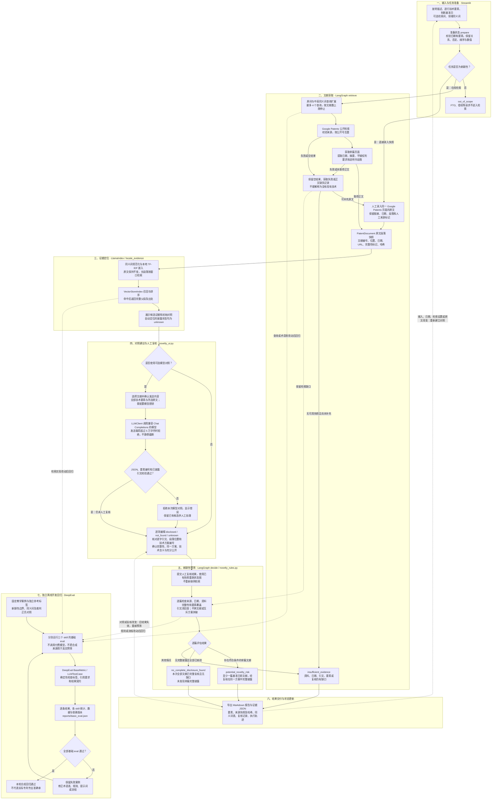

# Google Patents 新颖性预筛 Harness

> **材料接手与案件留存**：在现有主流程中接入材料上传、原件哈希、AI 对话整理要素与案件结果保存。使用与限制见 [材料接手说明](docs/local-integration.md)。保存材料不调用模型；原有人工复核与新颖性规则保持有效。

当前开发版本：**0.2.0**（第一阶段：材料可靠性，见 [VERSION](VERSION)）。[版本记录](CHANGELOG.md) · [版本与提交约定](CONTRIBUTING.md)。

保存新材料保留当前工作内容；显式切换前另存草稿。AI 整理结果按轮留存，文字附件引文可机械回查；材料未知项和未校验出处进入判断限制。检索改造、原文编号和人工复核记录改造尚未实施。

把一个发明想法整理成技术要素，从 **Google Patents** 获取文献，逐篇生成可回查原文的要素对照，再依据 **CNIPA 新颖性规则**给出有范围限制的预筛结果。

三个 skill 分别负责 **LangGraph 流程编排、LlamaIndex 证据检索、DeepEval 基础评测**，均有独立 Python 实现、中文注释、技能说明和基础 eval。

| 项目范围 | 当前实现 |
|---|---|
| 判断目标 | 中国发明/实用新型场景的新颖性预筛 |
| 资料来源 | 本次从 Google Patents 取得或人工录入的原文段落快照 |
| 比对单位 | 用户确认的整套技术要素；暂不区分独立/从属权利要求，不展开从属引用 |
| 人工复核 | 核对技术含义、引文、完整性、同一技术方案和充分公开 |
| 交付 | 新颖性 Markdown 报告、证据与判断 JSON、独立的基础 eval 记录 |

## 完整工作技术流程图

下图对应当前代码实现。**实线表示业务处理，虚线表示修改后的重新处理或离线评测关系。** 自动候选和模型建议都必须经过人工复核；离线 eval 不会为某份实际专利报告自动背书。



**执行细节：**状态图节点为 `prepare → retrieve → locate_evidence → decide`。第一次获取候选时尚未人工复核，因此通常返回“证据不足”；界面接受复核结果后，再用同一组快照重跑判断。人工编辑和可选模型调用由界面调度，不是隐藏的自动审批节点。快照先保存在当前会话中，导出 JSON 时才保存为可下载记录。

## 快速启动

在 `W:\patentai\patent_workflow` 文件夹运行：

```powershell
.\start_novelty.ps1
```

如果 PowerShell 限制脚本执行，可直接启动：

```powershell
.\.venv-novelty\Scripts\python.exe -X utf8 -m streamlit run app.py
```

首次从源码安装需要可用的 Python 3.10+：

```powershell
py -m venv .venv-novelty
.\.venv-novelty\Scripts\python.exe -m pip install -r requirements.txt
.\.venv-novelty\Scripts\python.exe -X utf8 -m streamlit run app.py
```

使用专用的 `.venv-novelty` 环境。三个框架的已验证版本固定在 [requirements.txt](requirements.txt)；LlamaIndex 只安装 core，默认使用本地嵌入。模型辅助可在侧栏设置，也可复制 [.env.example](.env.example) 为 `.env` 后填写；默认服务为 DeepSeek。

## 实际操作

1. **确认判断对象。**填写发明描述、基准日与技术要素，每行一个，保留连接关系、步骤、否定和数值。涉及优先权时，先人工确定适用基准日。
2. **取得文献。**点击第 1 步检索 Google Patents，或直接粘贴同一来源的原文。人工录入需填写链接、日期，并保留相关权利要求和说明书上下文。
3. **核对候选证据。**查看原文、段落编号、匹配提示和出处；低匹配分数不能证明某个特征不存在。
4. **按需使用模型建议。**选择文献并确认外发内容后调用模型；建议通过引文校验后仍需人工复核。也可以直接手工完成对照。
5. **提交复核并预筛。**逐项编辑披露状态、逐字引文、原文位置和方案编号。只有确认为同一技术方案的段落才能使用统一方案编号，不能合并互斥实施例。
6. **导出记录。**下载 Markdown 与 JSON。改变输入或原文需重建对照；改变已复核表格或确认状态后，需重新预筛才能导出更新结果。

### 要素对照状态

| 状态 | 表达的事实 | 复核要求 |
|---|---|---|
| `disclosed` | 该文献原文披露了这个技术要素 | 提供逐字引文、段落位置和方案编号；核对同义表述及全部限定 |
| `not_found` | 本次检查该文献时未找到这个要素 | 不能扩展为其他文献不存在，也不能当作产品缺少该要素 |
| `unknown` | 资料或技术含义不足以判断 | 保留不确定性，补充资料或人工核验 |

### 三类新颖性结果

| 结果 | 何时出现 | 应如何理解 |
|---|---|---|
| 发现单篇文献完整披露风险 | 至少一篇基准日前公开文献满足全部要素、同一方案、有效引文、完整资料及人工复核要求 | 提示新颖性风险，仍需专业复核 |
| 本次已复核文献中未发现完整披露 | 当前全部文献都已完整复核，无未知或其他缺口，且未发现单篇完整披露 | 仅说明本次证据范围内的结果，不能推导出可授权 |
| 证据不足 | 检索或正文失败、日期不明、要素未知、尚未复核，或存在其他待核验情况 | 补充证据并重新判断 |

FTO、侵权等其他任务返回 `out_of_scope`，不进入在线检索。

## 三个 skill 与代码分工

| Skill | 独立实现与说明 | 主要职责 |
|---|---|---|
| `patent-langgraph` | [langgraph_skill.py](skills/langgraph_skill.py) · [SKILL.md](.agents/skills/patent-langgraph/SKILL.md) | 状态图、同义词查询编排、有界获取、候选对照与规则调用 |
| `patent-llamaindex` | [llamaindex_skill.py](skills/llamaindex_skill.py) · [SKILL.md](.agents/skills/patent-llamaindex/SKILL.md) | 本地嵌入、索引、召回排序，返回未改写的父段和出处 |
| `patent-deepeval` | [deepeval_skill.py](skills/deepeval_skill.py) · [SKILL.md](.agents/skills/patent-deepeval/SKILL.md) | 三个 skill 的独立基础 eval、裁判自测及回归记录 |

其他关键文件：

| 文件 | 用途 |
|---|---|
| [app.py](app.py)、[novelty_ui.py](modules/novelty_ui.py) | 应用入口、会话状态、模型外发确认、人工对照和报告下载 |
| [patent_search.py](modules/patent_search.py)、[google_patent_documents.py](modules/google_patent_documents.py) | Google Patents 候选检索、正文解析和人工快照入口 |
| [novelty_models.py](modules/novelty_models.py) | 技术要素、原文段落、快照、对照及结果的数据契约 |
| [novelty_matching.py](modules/novelty_matching.py)、[synonyms.json](config/synonyms.json) | 中英同义词规范化、查询扩展和候选匹配提示 |
| [novelty_rules.py](modules/novelty_rules.py) | 来源、时间、引文及逐篇要素覆盖规则 |
| [novelty_report.py](modules/novelty_report.py) | Markdown 与 JSON 导出，保留判断输入和复核依据 |

## 同义词如何处理

术语表维护在 [config/synonyms.json](config/synonyms.json)，侧栏也可临时补充，每行一组，例如：

```text
压力传感器 | 压力感测器 | pressure sensor | pressure transducer
```

- 中英同义词、大小写和空格变体用于改善召回；召回后返回原始段落，不把规范化文本冒充逐字引文。
- 检索使用本地字符 TF-IDF 和人工术语表，是可解释基线，不能覆盖全部自然语言语义变化。
- 同义词匹配不能自动确认技术披露。人工仍须检查否定、数值、顺序、连接方向以及具体技术含义。
- 温度传感器与压力传感器、串联与并联、10 kPa 与 100 kPa、包含与不包含必须保持区别。
- 未收录术语或低相似度应保留待复核，可补充术语表或使用模型建议。

## 真实工程试运行：旋转咔嗒圆珠笔

已用 [US4968168A](https://patents.google.com/patent/US4968168A/en) 做单点随机修改试验，补充对照文献为 [US5944436A](https://patents.google.com/patent/US5944436A/en)。随机种子 `3862674471` 选中了 F6：**把环形齿冠材料从金属改为聚甲醛（POM）**，其余五项技术要素保持不变。

两次真实 DeepSeek 调用均成功；公开页面和检索入口本轮也成功访问。模型对变更项给出 `not_found` 建议。由于没有专业人员人工复核，原方案和修改版的 Harness 结果均保留为 `insufficient_evidence`，没有自动宣告可授权。

- [完整试运行结果 Markdown](reports/engineering_trial/engineering_trial.md)
- [运行用量、随机种子与检索记录](reports/engineering_trial/run_metadata.json)
- [原方案对照](reports/engineering_trial/original_report.md) · [修改版对照](reports/engineering_trial/modified_report.md)
- [真实原文快照](reports/engineering_trial/US4968168A_source.json) · [补充文献快照](reports/engineering_trial/US5944436A_source.json)
- [案例与候选变更配置](examples/engineering_trial.json) · [可复用试运行脚本](tools/run_engineering_trial.py)

使用已保存的真实快照复跑同一个修改点：

```powershell
.\.venv-novelty\Scripts\python.exe -X utf8 tools/run_engineering_trial.py --source-dir reports/engineering_trial --output-dir reports/engineering_trial_rerun --seed 3862674471
```

脚本通过隐藏输入读取 API Key，只在进程内存中使用；不要把密钥写入命令行或 Git。随机种子复现修改点选择，模型响应可能随运行变化。上传前可运行 `python tools/check_secrets.py --staged` 检查暂存区，扫描只输出可疑文件和行号。

## 基础 eval 与验证记录

侧栏可一键运行三个 skill 的基础 eval；它是独立离线回归，无需 API Key，不调用付费模型。

```powershell
.\.venv-novelty\Scripts\python.exe -X utf8 -m skills.deepeval_skill --output reports/basic_eval.json
.\.venv-novelty\Scripts\python.exe -X utf8 -m unittest discover -s tests -v
```

分别验证三个 skill：

```powershell
.\.venv-novelty\Scripts\python.exe -X utf8 -m unittest tests.test_novelty_skills.LangGraphSkillEvals -v
.\.venv-novelty\Scripts\python.exe -X utf8 -m unittest tests.test_novelty_skills.LlamaIndexSkillEvals -v
.\.venv-novelty\Scripts\python.exe -X utf8 -m unittest tests.test_novelty_skills.DeepEvalSkillEvals -v
```

2026-10-19 保存的验证记录：

| 检查 | 已记录结果 | 记录位置 |
|---|---|---|
| LangGraph 基础 eval | 20 / 20 | [basic_eval.json](reports/basic_eval.json) |
| LlamaIndex 基础 eval | 10 / 10 | [basic_eval.json](reports/basic_eval.json) |
| DeepEval 基础 eval | 4 / 4 | [basic_eval.json](reports/basic_eval.json) |
| 自动化测试 | 31 项通过，含界面操作、模型确认与结果失效 | [unittest.txt](reports/unittest.txt) |
| 依赖一致性 | 通过 | [dependency_check.txt](reports/dependency_check.txt) |
| Google Patents 实际连接 | 早期检查失败；后续工程案例已成功读取页面与检索 | [live_google_smoke.json](reports/live_google_smoke.json) |

用例见 [evals/basic_cases.json](evals/basic_cases.json)，设计说明见 [docs/novelty_eval_design.md](docs/novelty_eval_design.md)。已覆盖跨文献拼接、未知与缺失、增加要素、中英同义词及语序、否定、数值和连接关系、空结果、网络失败、互斥实施例、假引文、公开日期与潜在抵触申请。原 FTO 情形作为越界测试保留。

**34 条基础 eval 是教学合成回归，不代表实际专利专业准确率。** 正常预筛拒绝将 `synthetic_eval` 文献作为真实来源。真实金标准应由专业人员另行标注，记录来源、基准日、要素与引文，并隔离开发集和盲测集。界面外发流程使用模拟响应测试；真实工程案例另完成两次 DeepSeek 调用，记录见上方试运行报告。

## 数据流与适用边界

| 去向 | 发送或保存的内容 | 触发方式 |
|---|---|---|
| Google Patents | 检索词、扩展查询、单篇页面请求 | 点击在线检索 |
| 用户配置的模型服务 | 全部确认要素、所选文献编号和快照段落 | 选择文献、确认外发并点击模型按钮 |
| 下载到本地的文件 | 原文段落快照及哈希、日期、要素、术语表、对照、结果与执行轨迹 | 点击报告或证据 JSON 下载 |
| 基础 eval 记录 | 合成案例的逐条结果、各 skill 统计、数据和依赖版本 | 侧栏运行后下载，或使用 CLI 写入报告文件 |

规则依据为 [CNIPA《专利法》第二十二条](https://www.cnipa.gov.cn/art/2020/11/23/art_97_155167.html)及 [CNIPA 新颖性审查说明](https://www.cnipa.gov.cn/module/download/downfile.jsp?classid=0&filename=c7bc94c506844c54918b0e08dfbc5708.pdf&showname=report.pdf)。新颖性只是授权条件之一；未发现完整披露不能推出“可以申请成功”。

当前不自动判断优先权有效性、抵触申请成立条件、新颖性宽限期及其他特殊法律情形；需要核验的日期或申请历史保留为缺口。Google Patents 资料范围也不覆盖全部非专利文献、公开使用或其他公开证据。

## 常见问题与维护

**网页无法访问或只取得搜索摘要：**使用人工原文入口，粘贴同一 Google Patents 页面相关权利要求和说明书，保留链接、日期和上下文。已记录的检索错误不会自动消失，预筛仍会保留相应缺口；不要把失败或空结果解释为没有现有技术。

**对照看似匹配，仍输出证据不足：**检查完整性标记、公开日期、逐字引文、要素是否仍为 `unknown`，以及同一方案和充分公开是否已经人工确认。

**修改后仍看到旧记录：**改变输入、日期、检索设置或术语表后重新建立对照；改变对照或撤销复核确认后，重新运行第 3 步。

**调整实现后：**重跑基础 eval 与相关测试；需要重查网站连接时，可运行只检索公开通用词的检查：

```powershell
.\.venv-novelty\Scripts\python.exe -X utf8 tools/smoke_google.py
```

原背景搜索、草稿生成和排序模块保留为已有代码，当前入口不再调用。原 Harness 曾参考 [PatentGuard AI](https://github.com/joshuapremkumar/patentguard-ai) 的流水线，原项目采用 MIT 许可。
